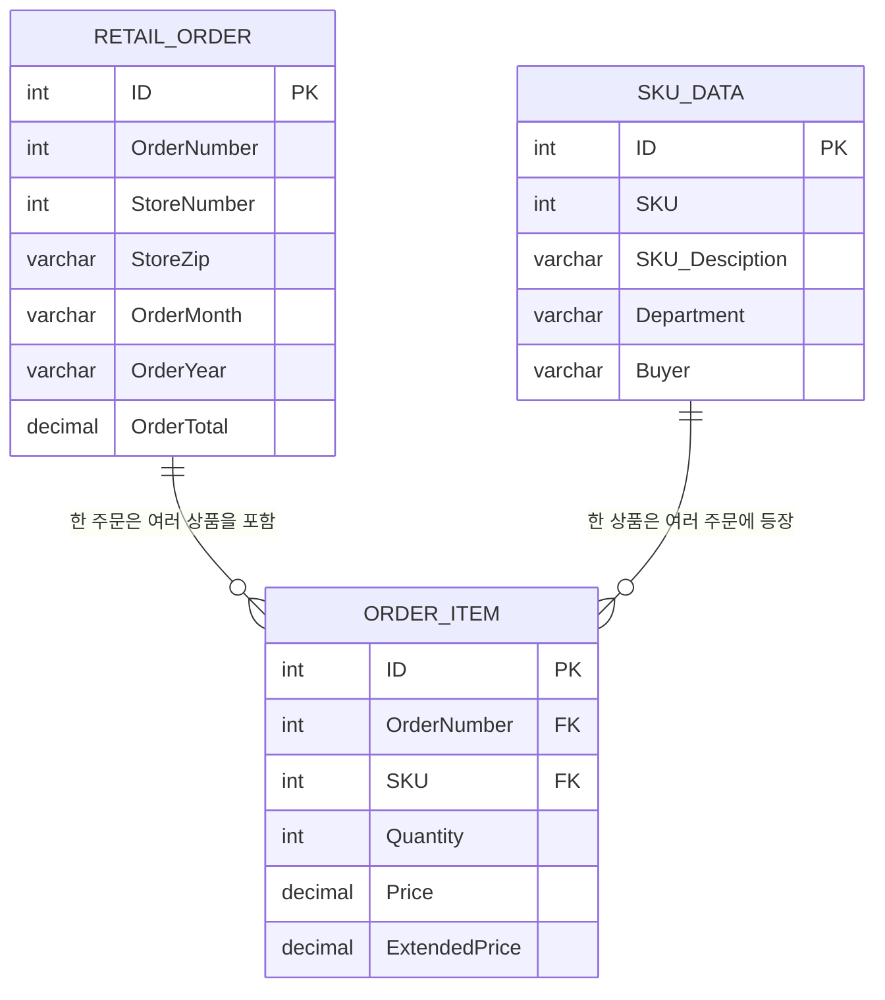
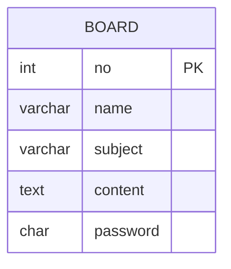

# movedb ER 다이어그램

`Lab1-2 SQL(Workbench).sql` 스크립트로 생성된 `movedb` 데이터베이스의 테이블 관계도입니다.
VS Code의 **Markdown Preview Enhanced** 확장으로 이 파일을 열고 미리보기(Ctrl+Shift+V 또는 우측 상단 미리보기 아이콘)를 켜면 아래 다이어그램이 그림으로 렌더링됩니다.

> 참고: 원본 SQL에는 실제 FOREIGN KEY 제약조건이 걸려있지 않습니다 (ENGINE=MyISAM, PK만 정의됨).
> 아래 관계는 컬럼명(OrderNumber, SKU)이 일치하는 것을 근거로 추론한 **논리적 관계**입니다.

## 참고: edb.board (별도 데이터베이스, 관계 없음)

