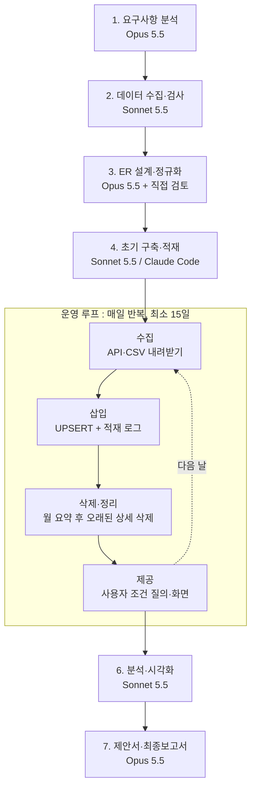

# 구현 파이프라인 : 지하철 무임승차 정보제공 시스템

> 위치 : `프로젝트/01_기획/04_1030_구현파이프라인_운영루프.md`
> 성격 : **데이터 분석 프로젝트가 아니라 정보제공 시스템.** 데이터가 최소 15일 이상 주기적으로 들어오고(삽입) 정리되는(삭제) 동안에도, 사용자가 조건을 넣으면 항상 맞는 정보를 돌려받아야 한다.

## 1. 분석 프로젝트와 무엇이 다른가

| 구분 | 데이터 분석 (빅데이터분석 때) | 정보제공 시스템 (이번) |
| --- | --- | --- |
| 데이터 흐름 | CSV를 한 번 읽고 끝 | 매일·주기적으로 새 데이터가 들어오고 오래된 데이터는 정리됨 |
| 결과물 | 분석 결과·그래프 한 벌 | 사용자가 조건을 넣으면 답이 나오는 질의·화면 |
| 핵심 질문 | "무엇을 발견했나" | "누가, 어떤 조건으로 물으면, 무엇을 돌려주나" |
| DB가 지켜야 할 것 | 거의 없음 | 중복 없이, 빠짐없이, 중간에 실패해도 깨지지 않게 |

그래서 설계의 중심이 "분석 모델"에서 **키·제약조건·트랜잭션·적재 이력**으로 옮겨간다. 분석·시각화는 과제 요구사항이라 유지하되, 시스템이 쌓은 데이터를 활용하는 마지막 단계로 둔다.

## 2. 전체 흐름

GitHub에서 아래 다이어그램이 그림으로 보인다.



## 3. 단계별 산출 파일과 모델

| 단계 | 산출 파일 (`04_본프로젝트/` 기준) | 모델 |
| --- | --- | --- |
| 1. 요구사항 분석 | `design/요구사항.md` | Opus 5.5 (채팅) |
| 2. 데이터 수집·검사 | `data/raw/출처.txt`, `src/01_explore.ipynb` | Sonnet 5.5 |
| 3. ER 설계·정규화 | `design/erd.png`, `sql/schema.sql` | Opus 5.5 + 직접 검토 |
| 4. 초기 구축·적재 | `src/load_initial.py` | Sonnet 5.5 (Claude Code) |
| 운영 루프 | `src/daily_update.py`, `sql/maintenance.sql` | Sonnet 5.5 (Claude Code) |
| 5. 사용자 질의 | `sql/queries.sql`, `src/service.py` | Sonnet 5.5 작성, 한 줄씩 직접 읽기 |
| 6. 분석·시각화 | `src/02_analysis.ipynb`, `output/` | Sonnet 5.5 (단순 셀은 Haiku 5.5) |
| 7. 보고서 | `02_제안서/`, `05_최종제출/` | Opus 5.5 |

## 4. 단계별로 고려할 것

### 1단계 : 요구사항 분석

정보시스템은 **사용자 · 검색 조건 · 결과**가 먼저 정해져야 한다. 예를 들면 "정책 담당자가 (역, 기간)을 넣으면 무임승차 비율과 고령 인구 대비 순위를 돌려준다", "고령 이용자·보호자가 (역, 요일, 시간대)를 넣으면 혼잡도와 엘리베이터 유무를 돌려준다" 같은 문장이다. 이 문장 하나가 질의 하나, 화면 하나가 된다.

여기에 운영 요구사항도 같이 적는다. 데이터 갱신 주기(매일? 월 1회?), 보관 기간(상세는 90일, 이후 월 요약만), 운영 기간(최소 15일, 날짜 명시)이다. 이 세 가지가 3·4단계 설계를 결정한다.

### 2단계 : 데이터 수집·검사

데이터를 **변하는 속도**로 나눈다.

| 종류 | 예시 | 처리 방식 |
| --- | --- | --- |
| 기준 데이터 | 역, 노선, 시설물 | 처음 한 번 적재, 바뀔 때만 수정 |
| 주기 갱신 데이터 | 혼잡도(분기), 자치구 인구(월) | 새 기준 시점이 나오면 해당 시점분만 교체 |
| 매일 쌓이는 데이터 | 역별 일별 승하차 | 운영 루프에서 매일 삽입 |

15일 이상 운영하려면 **매일 새로 나오는 데이터가 반드시 하나 있어야 한다.** 서울 열린데이터광장의 역별 일별 승하차가 매일 갱신되는 것으로 알고 있지만, 유·무임 구분이 일별로 제공되는지, 며칠 늦게 올라오는지, API 키 승인이 필요한지는 직접 확인해야 한다. 유·무임이 월 단위로만 나온다면 "일별 총 승하차 + 월별 유·무임 비율"로 나눠 설계한다.

검사할 것은 연결 키(역번호 체계, 역명 표기 차이), 결측, 중복 행, 데이터별 기준 시점이다.

### 3단계 : ER 설계·정규화

운영을 견디는 설계가 핵심이다.

- **복합 기본키로 중복 차단** : 일별 승하차는 `(역번호, 날짜)`가 기본키. 같은 날 데이터를 두 번 넣어도 한 행만 남는다.
- **외래키와 삭제 규칙** : 승하차 → 역 참조. 역을 지울 때 기록까지 지울지(`ON DELETE CASCADE`) 막을지(`RESTRICT`)를 정하고 이유를 보고서에 쓴다.
- **적재 이력 테이블** : 언제, 어떤 파일을, 몇 행 넣고 몇 행 지웠는지 기록. 15일 운영의 증빙이 된다.
- **상세/요약 분리** : `일별_승하차`(최근 상세)와 `월별_승하차`(요약)를 따로 둔다. 삭제는 요약을 만든 뒤에만 한다.
- **정규화 포인트** : 혼잡도 원본은 보통 시간대가 열로 펼쳐진 가로형(`5시30분`, `6시00분` …)이다. 반복되는 열 묶음이라 1NF를 깨는 구조이므로 `혼잡도(역번호, 요일구분, 방향, 시간대, 혼잡도, 기준분기)` 세로형으로 바꾼다. 보고서에 쓰기 좋은 정규화 사례다.
- **인덱스** : 사용자가 자주 거는 조건(역번호, 날짜)에 인덱스를 둔다.

```sql
CREATE TABLE load_log (
  load_id     INT AUTO_INCREMENT PRIMARY KEY,
  run_at      DATETIME NOT NULL,
  source      VARCHAR(100),
  rows_in     INT,
  rows_deleted INT,
  status      VARCHAR(10)          -- 성공 / 실패
);

CREATE TABLE ridership_daily (
  station_id  VARCHAR(10),
  use_date    DATE,
  boardings   INT,
  alightings  INT,
  load_id     INT,
  PRIMARY KEY (station_id, use_date),
  FOREIGN KEY (station_id) REFERENCES station(station_id),
  FOREIGN KEY (load_id)    REFERENCES load_log(load_id)
);
```

### 4단계 : 초기 구축과 운영 루프

초기 적재는 과거 데이터를 한 번에 넣는 작업이고, 운영 루프는 매일 도는 작은 작업이다. 운영 루프 스크립트는 세 가지를 지켜야 한다.

1. **여러 번 돌려도 결과가 같다 (멱등성)** : `INSERT ... ON DUPLICATE KEY UPDATE`로 이미 있는 날짜는 덮어쓴다. 실수로 두 번 실행해도 중복이 생기지 않는다.
2. **전부 되거나 전부 안 된다 (트랜잭션)** : 삽입·요약·삭제를 하나의 트랜잭션으로 묶어, 중간에 실패하면 `ROLLBACK`.
3. **모든 실행을 기록한다** : 성공이든 실패든 `load_log`에 한 줄.

```python
try:
    conn.begin()
    cur.executemany(
        """INSERT INTO ridership_daily (station_id, use_date, boardings, alightings, load_id)
           VALUES (%s, %s, %s, %s, %s)
           ON DUPLICATE KEY UPDATE boardings = VALUES(boardings),
                                   alightings = VALUES(alightings)""", rows)
    # 90일 지난 상세 → 월 요약에 반영 후 삭제
    cur.execute(open("sql/maintenance.sql").read())
    conn.commit()
except Exception:
    conn.rollback()
    # load_log에 '실패' 기록
```

자동 실행은 Windows 작업 스케줄러, cron, 또는 MySQL `EVENT` 중 하나를 쓴다. 노트북을 매일 켜두기 어렵다면 매일 정해진 시간에 직접 실행해도 되고, 어느 쪽이든 `load_log`가 운영 증빙이 된다.

### 5단계 : 사용자 질의 작성과 검토

질의는 분석용 일회성 쿼리가 아니라 **사용자 입력을 받는 질의**로 만든다. 1단계 요구사항 문장 하나당 질의 하나.

- 입력값은 문자열을 이어 붙이지 말고 자리표시자(`%s`)로 넘긴다. SQL 인젝션을 막고, 교재의 임베디드 SQL 형태 그대로다.
- 자주 쓰는 JOIN은 `VIEW`로 만들어 두면 질의가 짧아지고 설명하기 쉽다.
- 검토 방법 : (1) 결과 행 수가 예상과 맞는지, (2) JOIN 때문에 합계가 부풀지 않았는지(1:N 관계에서 SUM이 중복 집계되는 함정), (3) 없는 역·빈 기간을 넣었을 때 오류 대신 빈 결과가 나오는지, (4) `EXPLAIN`으로 인덱스를 타는지.
- **데이터가 바뀌어도 같은 질의가 맞는 답을 내는지** 확인한다. 운영 첫날과 15일째에 같은 질의를 돌려 결과가 자연스럽게 늘었는지 보는 것이 가장 확실한 테스트다.

```python
def free_ride_ratio(station_name, start, end):
    sql = """SELECT s.station_name, SUM(r.free_boardings) / SUM(r.total_boardings) AS ratio
             FROM v_ridership r JOIN station s ON r.station_id = s.station_id
             WHERE s.station_name = %s AND r.use_date BETWEEN %s AND %s
             GROUP BY s.station_name"""
    return pd.read_sql(sql, conn, params=(station_name, start, end))
```

### 6단계 : 분석·시각화

시스템이 쌓은 데이터를 활용하는 단계. 접근성 시설 가설(엘리베이터 수 ↔ 무임 비율) 회귀분석, 운영 기간 동안의 추이 그래프 등. 화면(Streamlit 등)은 선택 사항이지만, 사용자가 조건을 넣고 결과를 보는 모습을 보여주면 "정보시스템"이라는 점이 분명해진다.

### 7단계 : 보고서

제안서(11/3)에는 1~3단계 계획과 운영 방식(갱신 주기, 보관 기간, 운영 기간)을 쓴다. 최종보고서(12/10)에는 설계 절차와 함께 `load_log` 기록, 운영 첫날·마지막 날 질의 결과 비교를 증빙으로 넣는다.
