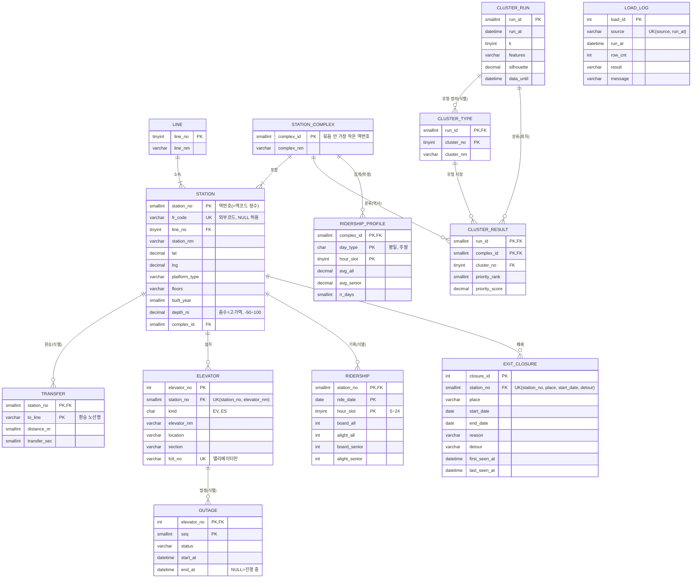

# E-R 다이어그램 (2026-11-17, 역사 묶음·분석 회차·집계 테이블 반영 2차)

`sql/01_schema.sql`(subway_access_db)을 기준으로 그린 논리 ERD이다. 요구사항은 `01_요구사항명세서.md`, 릴레이션 변환은 `03_릴레이션스키마.md`에 있다.

`design/ERD.png`는 역사 묶음을 추가하기 전(11/17 01:12)에 만든 그림이어서 STATION_COMPLEX, CLUSTER_RUN, RIDERSHIP_PROFILE이 빠져 있다. 그림을 만드는 `src/draw_erd.py`의 배치표(LAYOUT)에 세 테이블을 더한 뒤 다시 그려야 한다. [확인 필요: ERD.png 재생성] 보고서용 그림은 MySQL Workbench에서 Database → Reverse Engineer → `subway_access_db`로 다시 뽑아 비교한다.

## 1. 개체와 관계 도출

요구사항 명세(`01_요구사항명세서.md` 6장)의 명사에서 개체를, 동사에서 관계를 뽑았다.

| 구분 | 이름 | 비고 |
|---|---|---|
| 강한 개체 | 노선, 역사, 역, 승강기, 출입구폐쇄, 분석회차 | 각자 식별자를 가진다 |
| 약한 개체 | 환승, 비가동이력, 승하차, 군집유형 | 소유 개체(역, 승강기, 분석회차)의 키와 부분키로 식별한다. 군집유형(CLUSTER_TYPE)은 회차 안의 군집 번호와 이름을 담는다 |
| 관계 속성을 가진 M:N 관계 | 분류(분석회차 – 역사) | 군집 번호, 우선 관리 순위·점수를 속성으로 가진다. 릴레이션 CLUSTER_RESULT가 된다. 군집 이름은 (회차, 군집 번호)에 종속되므로 CLUSTER_TYPE으로 분리하였다(3NF) |
| 관리용 | 적재기록(LOAD_LOG) | 다른 개체와 관계가 없다 |
| 파생(물리 설계) | 이용 프로필(RIDERSHIP_PROFILE) | 승하차를 역사 단위로 집계한 값. 개념적 설계의 개체가 아니며 성능을 위해 더하였다 |

## 2. E-R 다이어그램

## 3. 관계와 카디널리티

괄호 안 수치는 2026-11-17 적재 결과로 확인한 참여 범위이다.

| 관계 | 참여 개체 | 카디널리티·참여 | 실측 | 구현 |
|---|---|---|---|---|
| 소속 | 노선 – 역 | 1:N, 역은 필수 참여 | 노선당 10~56개 역 | STATION.line_no FK |
| 포함 | 역사 – 역 | 1:N, 양쪽 필수 참여 | 역사당 1~3개 역(242개 역사, 278개 역) | STATION.complex_id FK |
| 환승(식별) | 역 – 환승 | 1:N, 환승은 필수 참여 | 140건 | TRANSFER PK(station_no, to_line) |
| 설치 | 역 – 승강기 | 1:N, 승강기는 필수 참여, 역은 선택 참여 | 승강기가 없는 역 4개(321, 2538, 2753, 2758) | ELEVATOR.station_no FK |
| 발생(식별) | 승강기 – 비가동이력 | 1:N, 이력은 필수 참여 | 수집 중 증가(11/17 기준 99건) | OUTAGE PK(elevator_no, seq), ON DELETE CASCADE |
| 기록(식별) | 역 – 승하차 | 1:N, 승하차는 필수 참여 | 역당 20~7,300행 | RIDERSHIP PK(station_no, ride_date, hour_slot) |
| 폐쇄 | 역 – 출입구폐쇄 | 1:N, 폐쇄는 필수 참여 | 8건 | EXIT_CLOSURE.station_no FK |
| 분류 | 분석회차 – 역사 | M:N, 관계 속성 cluster_no, priority_rank, priority_score | 회차마다 239개 역사 | CLUSTER_RESULT PK(run_id, complex_id), run_id는 ON DELETE CASCADE, (run_id, cluster_no)는 CLUSTER_TYPE을 참조 |
| 유형 정의(식별) | 분석회차 – 군집유형 | 1:N, 군집유형은 필수 참여 | 회차마다 k개 | CLUSTER_TYPE PK(run_id, cluster_no), run_id는 ON DELETE CASCADE |
| 집계(파생) | 역사 – 이용 프로필 | 1:N | 역사당 20~40행 | RIDERSHIP_PROFILE PK(complex_id, day_type, hour_slot) |

LOAD_LOG는 다른 개체와 관계가 없는 관리용 테이블이다.

분석 단위를 역사로 둔 이유: 환승역은 승하차·승강기가 한 호선 역번호로만 기록되는 경우가 있다(3호선 충무로 321은 노인 승하차 20일분이 모두 0명이고 4호선 충무로 423에 합산, 5호선 청구 2538은 승강기 0대이고 6호선 청구 2635에 15대 기록). 그래서 원천 자료는 호선별 역(STATION)에 붙이고, 분석 결과(CLUSTER_RESULT)와 집계(RIDERSHIP_PROFILE)는 역사(STATION_COMPLEX)에 붙인다.

## 4. 제안서 초안(그림 2·표 4·표 5)에서 바뀐 점

| 항목 | 제안서 초안 | 변경 | 이유 |
|---|---|---|---|
| 분석 단위 | 역(호선별), 환승역은 호선마다 별도의 역 | 역사(STATION_COMPLEX)를 추가하고 역은 반드시 하나의 역사에 속함. 질문 1~3의 분석과 대시보드는 역사 단위 | 환승역의 승하차·승강기가 한 호선 역번호로만 기록되어 역 단위 분석에서 한쪽이 0으로 나온다. 정규화한 역명이 같은 역을 묶고(예외: 4호선 총신대입구 → 이수) 278개 역을 242개 역사로 묶었다 |
| 분석 결과 | 역 – 분석결과 1:N, CLUSTER_RESULT(run_id, station_no, cluster_no) | 분석회차(CLUSTER_RUN) 개체 추가, 분석회차 – 역사 M:N 관계 "분류", CLUSTER_RESULT(run_id, complex_id, cluster_no, priority_rank, priority_score)와 CLUSTER_TYPE(run_id, cluster_no, cluster_nm) | 회차마다 군집 수·입력 지표·실루엣 계수·사용 자료 시각을 기록하고, 질문 3의 답인 군집 이름과 우선 관리 순위를 저장한다 |
| 집계 테이블 | 없음 | RIDERSHIP_PROFILE(역사 × 요일구분 × 시간대 평균) 추가 | 질문 1·2·3과 대시보드가 같은 평균을 반복해서 쓰며, RIDERSHIP 199만 행 직접 집계(1.2~2.0초) 대신 미리 계산한 값(0.02초)을 읽는다. 의도적 비정규화(`04_정규화.md` 6.1절) |
| 역 식별 | STATION(station_no, station_cd, …) | station_no = 역코드 정수, 외부코드 fr_code는 별도 후보키(UNIQUE, NULL 2개) | 승하차 역번호가 역코드를 정수로 쓴 값과 같음을 확인하여 역코드 열을 따로 둘 필요가 없다 |
| 정거장 깊이 | depth_m | depth_m을 역사심도 파일로 채우고 음수 허용(CHECK −50~100) | 역사심도 API(OA-13305)는 0건이어서 공공데이터포털 파일(15071319)을 썼다. 뚝섬 −19.07 등 고가역 24개가 음수이다 |
| 역 속성 | depth_m, platform_type, built_year | floors(층수), lat·lng(좌표) 추가 | 건축정보(OA-11572)와 좌표(OA-22534)를 연결하였다 |
| 환승 | 역 – 역 M:N 순환 관계, TRANSFER(from_station, to_station) | 역 – 환승 1:N, TRANSFER(station_no, to_line) | 환승역 거리 자료(OA-13290) 140건 중 54건의 환승 대상이 공항철도·경의중앙선 등 범위 밖 노선이어서 대상 역을 STATION FK로 걸 수 없다 |
| 승강기 식별 | elevator_no(원천 ID 가정) | 대리키 elevator_no + UNIQUE(station_no, elevator_nm), 엘리베이터만 fclt_no | 가동현황 API(OA-15994)에 승강기 ID가 없고, (역코드, 승강기명)이 유일하다 |
| 승강기 높이 | ELEVATOR.height_m | 제외 | 길이·높이 정보(OA-12514)가 API 서버 오류였고 파일도 확보하지 못하였다. 수직 이동 부담은 정거장 깊이로 본다 |
| 전체 승하차 2025년 | 파일(연) | 공공데이터포털 파일(15048032)로 적재 | 전체 승하차 API는 2023~2024년만 제공한다 |
| 출입구 폐쇄 | closure_id, place, 기간, reason, detour | first_seen_at, last_seen_at 추가, UNIQUE(station_no, place, start_date, detour) | 매시 수집에서 같은 건을 중복 저장하지 않고, 처음·마지막 관측 시각으로 폐쇄 등록·해제를 추적한다 |
| 적재 기록 | load_id, source, run_at, row_cnt, result | message 추가, UNIQUE(source, run_at) | 수집 스냅샷마다 1행을 남겨 빠진 수집 시각을 찾는다 |
