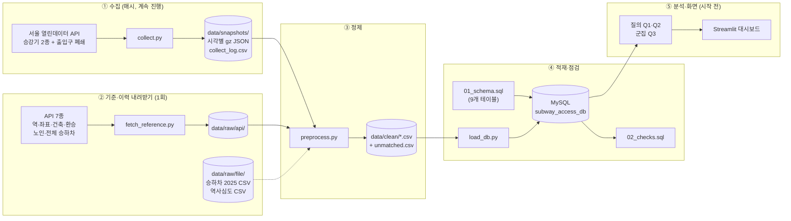

# 데이터 파이프라인 현황 (11/17 기준)

> 원본 데이터가 어떤 단계를 거쳐 DB와 화면에 이르는지, 지금 어디까지 구현되어 있는지를 한 장에 정리한다.
> 단계별 할 일과 담당은 `README.md`, 설계 근거는 `design/`, 날짜별 결정은 `진행기록.md`에 있다.

## 1. 전체 흐름



점선은 연결이 아직 완전하지 않다는 뜻이다(5장 참고).

## 2. 단계별 상세

| 단계 | 프로그램 | 입력 | 출력 | 상태 |
|---|---|---|---|---|
| ① 수집 | `src/collect.py` | OA-15994 승강기 가동현황(2,809건), OA-22740 엘리베이터(871건), OA-22122 출입구 폐쇄(8건) | `data/snapshots/{source}/YYYYMMDD_HHMM.json.gz`, `collect_log.csv` | 개인 PC에서 11/17 01:00부터 매시 실행 중. 연구실 서버로 확대 예정 |
| ② 내려받기 | `src/fetch_reference.py` | API 9종 중 기준 정보·승하차(역, 좌표, 건축, 심도, 승강기 크기, 환승, 노인·전체 승하차) | `data/raw/api/*.json.gz` | 완료, 1회성 |
| ③ 정제 | `src/preprocess.py` | ①②의 원본 | `data/clean/` 8개 CSV와 `unmatched.csv` | 완료. 수집분이 늘면 다시 실행 |
| ④ DDL | `sql/01_schema.sql` | — | 테이블 9개, FK 7개 (`subway_access_db`) | 완료 |
| ④ 적재 | `src/load_db.py` | `data/clean/*.csv` | MySQL 테이블, `load_log` | 완료. 승하차 1,993,840행 포함 40초. 다시 실행해도 결과 동일 |
| ④ 점검 | `sql/02_checks.sql` | DB | 고아 행·값 범위·기간 역전 점검 | 현재 모두 0행 |
| ⑤ 질의·분석 | `sql/03_queries.sql`, `src/analysis.py` | DB | Q1·Q2 결과, 역 군집 | 시작 전 |
| ⑤ 화면 | `src/app.py` (Streamlit) | DB | 교통약자·관리자 화면 | 시작 전 |

보조 도구: `src/draw_erd.py`(DB 스키마 → `design/ERD.png`), 테스트 `tests/test_collect.py`, `tests/test_preprocess.py`.

## 3. 핵심 변환: 스냅샷 → OUTAGE

승강기 비가동 이력은 API가 직접 주지 않는다. 시각별 스냅샷을 이어 붙여 만든다.

```
스냅샷 t1: A=사용가능, B=사용가능
스냅샷 t2: A=보수중,   B=사용가능   ← A의 비가동 시작 (start_at = t2)
스냅샷 t3: A=사용가능, B=사용가능   ← A의 비가동 종료 (end_at = t3)
```

- `preprocess.py`의 `outage_intervals`가 직전 스냅샷과 비교해 시작·종료 시각을 기록한다.
- 지금은 스냅샷이 11/17 00:56, 00:57, 01:00 세 개뿐이라 `outage.csv`에는 수집 시작 시점에 이미 보수 중이던 75건이 `start_at`만 있고 `end_at`이 비어 있다.
- 수집을 시작하기 전에 이미 시작된 보수는 실제 시작 시각을 알 수 없다. 이 건들을 통계에서 어떻게 다룰지(첫 관측 시각 이후만 세는 등) 정해야 한다.
- 수집이 빠진 시각의 처리 규칙은 미정이다 (`인수인계_서버수집.md` 5장).

## 4. 데이터 규모 (현재)

| 데이터 | 건수 | 비고 |
|---|---|---|
| STATION | 278개 | 역코드(STN_CD) 정수가 PK, 278개 모두 승하차와 연결 |
| ELEVATOR | 2,750개 | 에스컬레이터 포함 (WL·MW 제외 규칙 확인 필요) |
| RIDERSHIP | 1,993,840행 | 노인·전체 승하차를 시간대 행으로 변환 |
| TRANSFER | 140건 | 범위 밖 노선 포함으로 (역, 환승 노선명)으로 단순화 |
| OUTAGE | 75건 | 모두 진행 중. 스냅샷 3개뿐이어서 종료된 건이 없음 |
| EXIT_CLOSURE | 8건 | |
| 스냅샷 | 소스당 3개 (11/17 00:56~01:00) | 1회 약 58KB, 3주 약 30MB 예상 |

## 5. 아직 이어지지 않은 곳 (병목)

1. **수집 → 정제 자동 연결 없음.** 수집은 매시 돌지만 `preprocess.py`와 `load_db.py`는 수동 실행이다. README 2-8번(수집기를 DB 적재까지 연결)이 이 일이다.
2. **수집 PC 한 대에 의존.** 개인 PC가 꺼지면 그 시간은 영구 결측이다. 연구실 서버 수집이 이를 보완한다(`인수인계_서버수집.md`).
3. **2025년 전체 승하차 일부 부족.** 전체 승하차 API는 2023~2024년만 있어 2025년 노인 비중 계산에는 `data/raw/file/`의 파일을 써야 한다. 그 파일을 정제에 연결했는지 확인이 필요하다.
4. **환승역 한 호선 코드 문제.** 환승역은 승하차·승강기가 한 호선 코드로만 기록된다. 역 군집(Q3)은 역사 단위로 묶어야 하므로, 역사 묶음을 STATION 속성으로 둘지 별도 테이블로 분리할지 정해야 한다.
5. **README 진행표와 코드의 어긋남.** README에는 `load_base.py`, `build_outage.py`, `load_closure.py`가 완료로 표시되어 있지만, 실제로는 `preprocess.py`와 `load_db.py` 두 파일이 그 일을 모두 한다. 담당과 산출물 이름을 현실에 맞게 고치는 것이 좋다.

## 6. 다음 단계

| 순서 | 할 일 | 관련 단계 |
|---|---|---|
| 1 | 서버에서 수집 시작, 다음 날 아침 스냅샷 24개 확인 | 0단계 (0-6) |
| 2 | 부족한 파일 데이터 확보와 역 코드 대응표 마무리 | 1단계 (1-1~1-3) |
| 3 | 요구사항 명세서, 정규화 문서, 물리 설계 확정 | 1단계 (1-4, 1-7, 1-8) |
| 4 | 수집 → 정제 → 적재 자동 연결 | 2단계 (2-8) |
| 5 | Q1·Q2 질의, 군집 분석, 시각화 | 3단계 |
| 6 | Streamlit 대시보드, 12/3 발표 | 4단계 |

## 7. 실행 순서 요약

```powershell
# 저장소 루트에서 (기준 정보는 한 번만)
uv run python 04_본프로젝트/src/fetch_reference.py     # ② 기준·이력 내려받기
uv run python 04_본프로젝트/src/preprocess.py          # ③ 정제
Get-Content -Raw -Encoding UTF8 04_본프로젝트/sql/01_schema.sql | mysql --login-path=endb   # ④ DB 다시 만들기 (기존 데이터 삭제)
uv run python 04_본프로젝트/src/load_db.py             # ④ 적재
mysql --login-path=endb subway_access_db < 04_본프로젝트/sql/02_checks.sql                  # ④ 점검
```

수집분을 DB에 반영하려면 `preprocess.py` → `load_db.py`만 다시 실행하면 된다(`load_db.py`는 다시 실행해도 결과가 같다). DDL 재실행은 기존 데이터를 지우므로 스키마를 바꿀 때만 한다.
